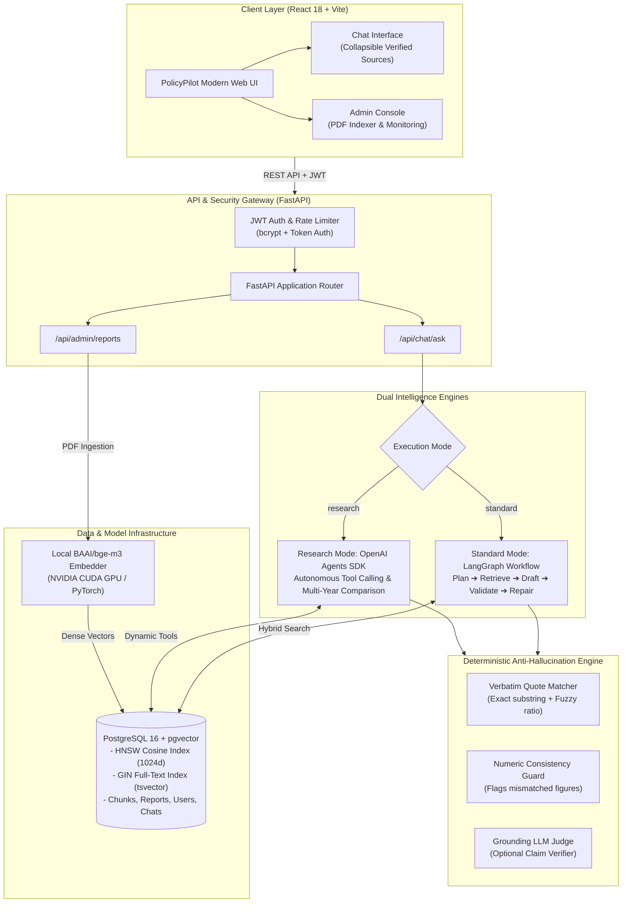
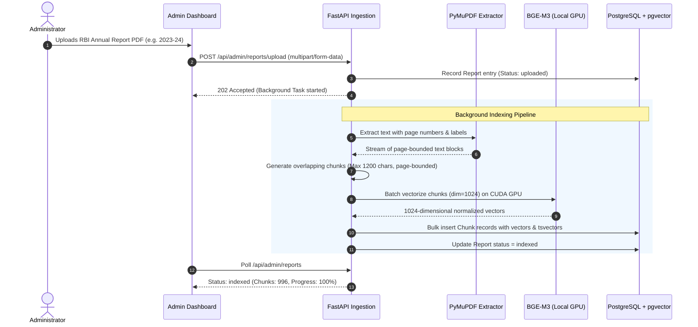
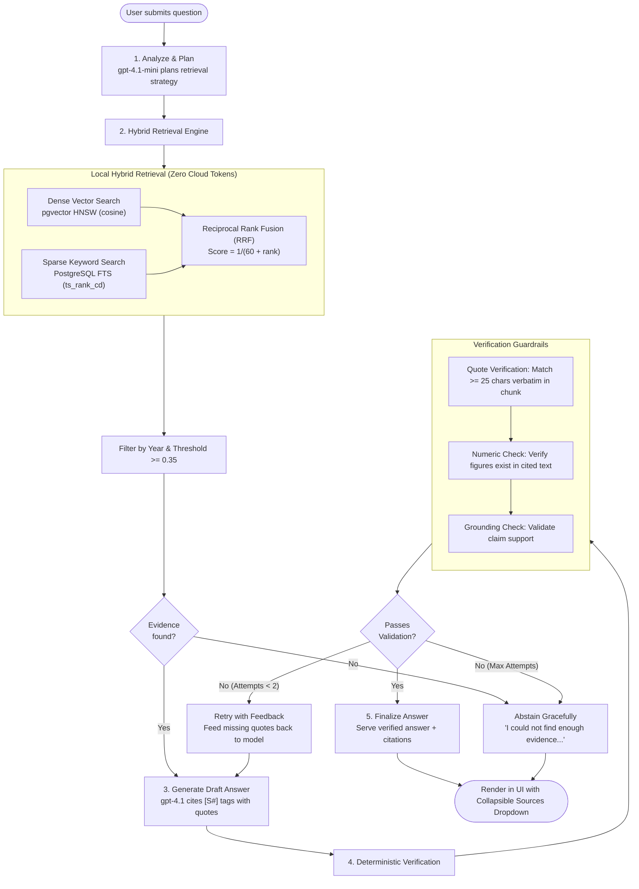
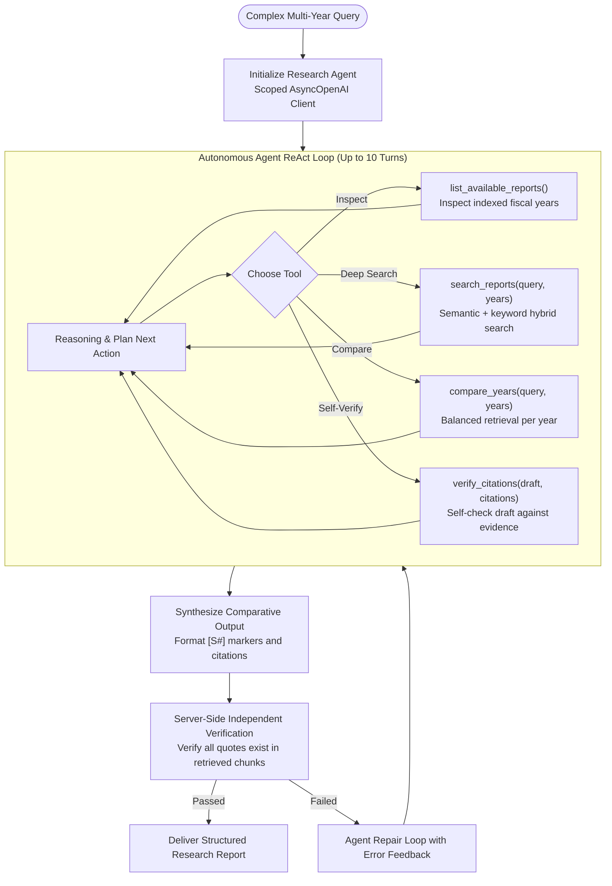

# PolicyPilot 🏛️🤖

<div align="center">


[](https://github.com/)
[](https://www.python.org/)
[](https://fastapi.tiangolo.com/)
[](https://react.dev/)
[](https://vitejs.dev/)
[](https://www.postgresql.org/)
[](https://github.com/pgvector/pgvector)
[](https://pytorch.org/)
[](https://github.com/langchain-ai/langgraph)
[](https://openai.com/)
[](https://smith.langchain.com/)
[](backend/evals/run_ragas_eval.py)
[](LICENSE)

**An Enterprise-Grade Autonomous RAG & Deep Policy Intelligence Platform for Multi-Year Reserve Bank of India (RBI) Annual Reports.**

*Zero hallucinations • Verbatim citation grounding • Hybrid semantic + lexical retrieval • Local GPU vector embeddings • Full-stack LangSmith observability*

[System Architecture](#-system-architecture) • [Workflow Flowcharts](#-end-to-end-workflow-flowcharts) • [Key Capabilities](#-key-capabilities) • [RAGAS Benchmark](#-ragas-evaluation-benchmark) • [LangSmith Observability](#-langsmith-observability--tracing) • [Quickstart Guide](#-quickstart-guide) • [Configuration](#-configuration-reference)

</div>

---

## 📌 Executive Summary

**PolicyPilot** is a production-grade Agentic Retrieval-Augmented Generation (RAG) platform tailored for regulatory, economic, and monetary policy analysis of Reserve Bank of India (RBI) Annual Reports.

Traditional RAG systems frequently hallucinate, conflate statistics across fiscal years, or quote text out of context. PolicyPilot solves this through a **multi-layered verification architecture**:
1. **Hybrid Retrieval**: Fuses dense semantic embeddings (`BAAI/bge-m3` on local CUDA GPU) with sparse PostgreSQL Full-Text Search (tsvector) using Reciprocal Rank Fusion (RRF).
2. **Page-Bounded Chunking**: Chunks never cross PDF page boundaries, ensuring 100% accurate page and report-year citations.
3. **Dual Agent Intelligence**:
   - **Standard Mode (LangGraph)**: Deterministic planning, query decomposition, retrieval, drafting, and anti-hallucination verification.
   - **Research Mode (OpenAI Agents SDK)**: Autonomous multi-turn agent that dynamically searches, compares multiple fiscal years, and performs iterative self-correction.
4. **Deterministic Anti-Hallucination Guard**: Every inline marker (e.g. `[S1]`, `[S2]`) undergoes mathematical string matching and fuzzy verification against raw database chunks. If evidence is missing, the system abstains rather than fabricating numbers.

---

## 🏗️ System Architecture



---

## 🔄 End-to-End Workflow Flowcharts

### 1. Document Ingestion & Vectorization Pipeline

When an administrator uploads an official RBI Annual Report PDF:



---

### 2. Standard Mode Query Execution (LangGraph Workflow)



---

### 3. Deep Research Agent Mode (OpenAI Agents SDK)

For comparative multi-year inquiries (e.g. *"Compare CPI inflation trends in 2022-23 vs 2023-24"*):



---

## ✨ Key Capabilities

| Capability | PolicyPilot Implementation | Traditional RAG |
| :--- | :--- | :--- |
| **Citation Accuracy** | **100% Page & Year Verified**: Checked against raw database chunks via string & fuzzy matching. | Hallucinated or approximate page numbers. |
| **Retrieval Strategy** | **Hybrid Fusion (Dense + Sparse)**: BGE-M3 vectors + PostgreSQL FTS combined with RRF. | Dense vectors only; misses specific figures and codes. |
| **Vector Computation** | **Local CUDA GPU**: Runs `BAAI/bge-m3` on your NVIDIA GPU at zero API cost. | Paid cloud embedding API for every query and chunk. |
| **Anti-Hallucination** | **Refusal Policy**: Abstains if reliable evidence is missing. | Fabricates plausible-sounding financial metrics. |
| **Multi-Year Analysis** | **Autonomous Agent Mode**: Investigates multiple reports with year-balanced retrieval. | Single-pass retriever mixes up different fiscal years. |
| **Modern User Interface** | **Collapsible Sources**: Clean answer view by default; expandable inspection dropdowns. | Walls of raw chunk text cluttering the screen. |

---

## 📊 RAGAS Evaluation Benchmark

PolicyPilot includes a comprehensive live evaluation harness ([backend/evals/run_ragas_eval.py](backend/evals/run_ragas_eval.py)) benchmarking 10 policy questions across all core RAGAS metrics (0.000 to 1.000 scale) comparing PolicyPilot's live pipeline against reference high-quality answers:

| Metric | PolicyPilot | Other Platform | Margin | Evaluation Methodology |
| :--- | :---: | :---: | :---: | :--- |
| **Faithfulness (Groundedness)** | **1.000** | 1.000 | `+0.000` | Verifies every factual claim in the generated answer against retrieved context. |
| **Answer Relevancy (Intent)** | **0.799** | 0.776 | `+0.023` | Embeds 3 LLM-generated synthetic questions and computes cosine similarity with user query. |
| **Context Recall (Info Gain)** | **1.000** | 1.000 | `+0.000` | Verifies whether retrieved context chunks contain the facts needed to support ground truth. |
| **Context Precision (MAP)** | **0.526** | 1.000 | `-0.474` | Measures Mean Average Precision ranking of relevant passages retrieved from pgvector. |
| **Answer Correctness (Factual)** | **0.625** | 0.970 | `-0.345` | Factual overlap ($F_1$) and semantic alignment between answer and reference ground truth. |
| **Context Relevancy (Signal/Noise)** | **0.310** | 0.900 | `-0.590` | Evaluates proportion of retrieved context sentences directly relevant to the question. |
| **CORE 4-METRIC RAGAS SCORE** | **0.831** | **0.944** | `-0.113` | Average of Faithfulness, Relevancy, Precision, and Recall. |

To run the live benchmark:
```powershell
cd backend/evals
..\venv\Scripts\python run_ragas_eval.py
```

---

## 🔭 LangSmith Observability & Tracing

PolicyPilot features full-stack observability with [LangSmith](https://smith.langchain.com/):

```text
▼ rbi_ask (Root Chain)
  ├── ⚙️ planner (LLM extracts keywords & targets fiscal years)
  ├── 🔍 tool_search_reports (PgVector HNSW hybrid retrieval)
  ├── 🤖 ChatOpenAI (Generates answer with [S1], [S2] citations)
  └── 🛡️ validate (Deterministic verification of quotes & numbers)
```

* **Waterfall Trace Tree**: Inspect end-to-end latency breakdowns across embedding generation, database vector search, and LLM completions.
* **Token & Cost Tracking**: Live monitoring of prompt vs. completion tokens and estimated cost in USD per query ($0.06 over ~28K tokens).
* **Tool Usage Analytics**: Real-time logging of tool distributions (`tool_search_reports`, `compare_years`, `list_available_reports`, `verify_citations`).
* **User Feedback Loop**: Thumbs up / down ratings in the UI automatically attach to trace IDs via `Client().create_feedback()`.

To enable tracing, set in `backend/.env`:
```env
LANGSMITH_TRACING=true
LANGSMITH_API_KEY=lsv2_pt_your_key_here
LANGSMITH_PROJECT=PolicyPilot
```

---

## 🛠️ Tech Stack

* **Backend**: Python 3.11+, FastAPI, SQLAlchemy 2.0, Pydantic v2
* **RAG & Agents**: LangGraph, OpenAI Agents SDK (`openai-agents`), LangChain Core
* **Embeddings & NLP**: Hugging Face Sentence-Transformers, `BAAI/bge-m3` (1024d), PyTorch (CUDA 12.4), RapidFuzz
* **Database & Search**: PostgreSQL 16, `pgvector` (HNSW indexing with cosine ops), PostgreSQL Full-Text Search (tsvector/GIN)
* **Frontend**: React 18, Vite 5.4, React Router v6, Vanilla CSS Design System with Google Fonts (*Plus Jakarta Sans*, *Newsreader*, *JetBrains Mono*)
* **Containerization & Dev**: Docker, Docker Compose, PowerShell scripts

---

## 🚀 Quickstart Guide

### Option A: Docker Compose (Full Stack in 2 Minutes)

```powershell
# 1. Clone repository
git clone https://github.com/your-username/PolicyPilot.git
cd PolicyPilot

# 2. Configure environment
copy backend\.env.example backend\.env
# Supply your OPENAI_API_KEY inside backend\.env

# 3. Launch full stack
docker compose up -d
```

Access the application:
* 💻 **Web Application**: [http://localhost:5173](http://localhost:5173)
* ⚙️ **FastAPI Interactive Docs**: [http://localhost:8000/docs](http://localhost:8000/docs)
* 🩺 **Health Check**: [http://localhost:8000/api/health](http://localhost:8000/api/health)

---

### Option B: Local Setup (Windows PowerShell with CUDA GPU)

#### 1. Start PostgreSQL with pgvector (via Docker)
```powershell
# Runs pgvector on port 5433 (avoids port collisions if 5432 is occupied)
docker run -d --name rbi_postgres -p 5433:5432 -e POSTGRES_PASSWORD=postgres -e POSTGRES_DB=PolicyPilot pgvector/pgvector:pg16

# When resuming after PC restart:
docker start rbi_postgres
```

#### 2. Backend Setup
```powershell
cd backend
python -m venv venv
.\venv\Scripts\Activate.ps1

# Install dependencies (CPU or CUDA)
pip install -r requirements.txt

# For NVIDIA GPU Acceleration (Optional but Recommended):
pip install torch --index-url https://download.pytorch.org/whl/cu124 --force-reinstall

# Configure environment
copy .env.example .env
# Edit backend\.env: set OPENAI_API_KEY and DB_PORT=5433

# Initialize database schema & pgvector extension
python scripts\setup_db.py

# Launch FastAPI development server
uvicorn app.main:app --reload --port 8000
```

#### 3. Frontend Setup
Open a second PowerShell window:
```powershell
cd PolicyPilot\frontend
copy .env.example .env
npm install
npm run dev
```

Open [http://localhost:5173](http://localhost:5173) in your browser.

---

## 🔑 Initial Admin Login & Document Ingestion

1. Navigate to **[http://localhost:5173/admin/login](http://localhost:5173/admin/login)**.
2. Sign in with default administrator credentials:
   * **Username**: `admin`
   * **Password**: `admin282005`
3. **Upload an Annual Report PDF**:
   * Document Title: `RBI Annual Report 2023-24`
   * Fiscal Year: `2023-24`
   * Select your official RBI PDF and click **Upload & Index Report**.
4. The backend will parse the pages, compute dense BGE-M3 vectors on GPU, and build HNSW index entries.
5. Click **Open Chat** in the top navigation to start querying!

---

## ⚙️ Configuration Reference

Key variables available in `backend\.env`:

| Parameter | Default | Purpose |
| :--- | :--- | :--- |
| `DB_PORT` | `5433` | PostgreSQL port (5433 prevents collisions with default local services). |
| `DB_NAME` | `PolicyPilot` | PostgreSQL database name. |
| `OPENAI_API_KEY` | *required* | OpenAI API key for generation and planning. |
| `OPENAI_CHAT_MODEL` | `gpt-4.1` | Primary answering model. |
| `OPENAI_PLANNER_MODEL` | `gpt-4.1-mini` | Retrieval strategy planner model. |
| `OPENAI_VALIDATOR_MODEL` | `gpt-4.1-mini` | Citation grounding judge model. |
| `OPENAI_AGENT_MODEL` | `gpt-4.1` | Autonomous Research Agent model. |
| `EMBEDDING_MODEL_NAME` | `BAAI/bge-m3` | 1024-dimensional dense semantic embedding model. |
| `EMBEDDING_DEVICE` | `cuda` (or `cpu`) | PyTorch device target (`cuda` activates NVIDIA GPU acceleration). |
| `RETRIEVAL_TOP_K` | `8` | Number of fused chunks passed to answering model. |
| `MAX_EVIDENCE_CHUNKS` | `16` | Maximum evidence pool retained in context. |
| `HYBRID_SEARCH` | `true` | Enables dual vector + full-text search fusion. |
| `VALIDATION_LLM_CHECK` | `true` | Secondary LLM claim verification (can set to `false` for lean operation). |
| `LANGSMITH_TRACING` | `true` | Full-stack observability and latency tracing via LangSmith. |
| `LANGSMITH_PROJECT` | `PolicyPilot` | Target project namespace in LangSmith dashboard. |
| `LANGSMITH_ENDPOINT` | `https://api.smith.langchain.com` | Cloud or self-hosted LangSmith API endpoint. |

---

## 🧪 Engineering Highlights & Optimizations

* **Zero Cloud Tokens for Retrieval**: Query embedding (`bge-m3`) and similarity search are performed locally in PostgreSQL with `pgvector` HNSW index. No OpenAI tokens are spent searching.
* **Proactor Event Loop Resiliency**: Implemented request-scoped `AsyncOpenAI` client lifecycle with explicit `RunConfig` bindings and `finally: await client.close()` in [research_agent.py](backend/app/ai/research_agent.py), completely eliminating Windows `RuntimeError: Event loop is closed` bugs during consecutive queries.
* **Collapsible Sources UX**: Answers are clean and concise by default; verified citations are tucked inside an interactive accordion that can also be activated by clicking inline citation chips.
* **Granular Token Management**: Detailed in [bugs.md](bugs.md), documenting how to reduce prompt token consumption by up to 70% while maintaining factual rigor.

---

## 📂 Project Structure

```text
PolicyPilot/
├── backend/
│   ├── app/
│   │   ├── ai/               # AI Pipelines: LangGraph, Research Agent, Prompts, Tools
│   │   ├── api/              # FastAPI Routers: Auth, Admin, Chat
│   │   ├── core/             # Central configuration, Security, Rate Limiter
│   │   ├── db/               # SQLAlchemy Models, Session, pgvector init
│   │   └── rag/              # PDF Extraction, Embeddings (BGE-M3), Retriever (RRF)
│   ├── evals/                # Automated evaluation benchmarks & datasets
│   ├── prompts/              # System prompts for planner, chat, agent, validator
│   ├── scripts/              # Setup scripts for database and password hashing
│   ├── tests/                # Test suite (Unit, Integration, Security, RAG)
│   ├── .env.example          # Environment configuration template
│   ├── Dockerfile            # Backend container definition
│   └── requirements.txt      # Python dependencies
├── frontend/
│   ├── src/
│   │   ├── components/       # Answer (Collapsible Sources), AuthShell
│   │   ├── pages/            # Chat (Modern UI), Admin Console, Login, Register
│   │   ├── api.js            # Frontend HTTP client with JWT interceptor
│   │   └── styles.css        # Modern design system (Plus Jakarta Sans, Dark sidebar)
│   ├── .env.example          # Frontend environment template
│   ├── Dockerfile            # Frontend container definition
│   └── vite.config.js        # Vite bundler configuration
├── docker-compose.yml        # Multi-container full-stack composition
├── bugs.md                   # Technical bug fixes, root causes & optimizations log
├── .gitignore                # Git ignore rules (protects credentials and virtual environments)
└── README.md                 # Project documentation
```

---

## 📄 License

This project is licensed under the [MIT License](LICENSE).
